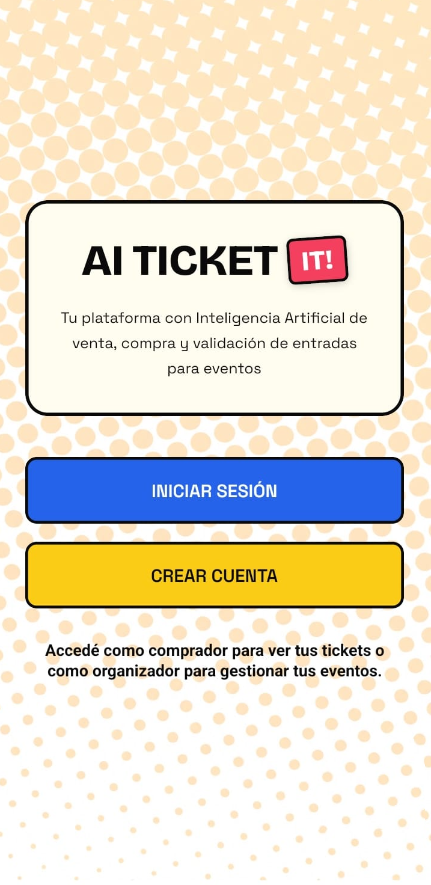

## **AI Ticket It - Plataforma de Venta de Entradas para Eventos**



Trabajo Práctico Individual de 
Desarrollo con Inteligencia Artificial
-2C 2026-


## **Contexto general**


Durante los últimos años, la industria del entretenimiento en vivo creció de forma sostenida: recitales, obras de teatro, festivales, conferencias y eventos deportivos convocan cada vez a más público. Cada vez más personas buscan descubrir eventos de su interés y adquirir entradas de forma rápida y segura desde su teléfono, sin necesidad de hacer filas en boleterías. En paralelo, miles de productores independientes, salas y organizadores eligen publicar sus propios eventos y gestionar la venta de entradas de manera autónoma.

En este contexto, surge la necesidad de plataformas que permitan conectar de manera simple y segura a quienes organizan eventos con quienes desean asistir. Los organizadores requieren herramientas que les permitan publicar sus eventos, definir los distintos tipos de entrada disponibles (por ejemplo, General, Platea o VIP), establecer precios y cupos, y administrar las ventas realizadas. Por su parte, los compradores buscan soluciones que les permitan explorar eventos por categoría, buscar espectáculos específicos mediante una barra de búsqueda y comprar sus entradas de manera rápida y confiable.

Como respuesta a esta necesidad, una organización ha solicitado el desarrollo de AI Ticket It, una plataforma orientada a la publicación de eventos y la venta de entradas. Dentro del sistema, los organizadores podrán crear y gestionar sus eventos, incluyendo descripciones detalladas, fecha de realización, material multimedia y distintos tipos de entrada según ubicación, precio y cupo disponible. Los compradores, a su vez, podrán navegar el catálogo de eventos, filtrar por categorías, guardar eventos favoritos y comprar las entradas que mejor se adapten a sus necesidades.

Una vez realizada una compra, el sistema permitirá realizar un seguimiento de la compra hasta el día del evento. Las compras atravesarán distintas etapas que reflejan su situación (pendiente de pago, confirmada, utilizada, cancelada o reembolsada), permitiendo tanto al comprador como al organizador conocer el estado actual y realizar las acciones correspondientes en cada momento. Además, cada compra contará con un espacio de comunicación simple donde ambas partes podrán intercambiar mensajes para realizar consultas sobre el evento, el acceso al lugar o eventuales cambios de fecha.
Una vez finalizado el evento, los asistentes podrán calificar su experiencia mediante un puntaje y un comentario, permitiendo que futuros compradores conozcan la reputación de cada organizador. Para acompañar este flujo, la plataforma buscará brindar una experiencia clara, ordenada y transparente, facilitando la organización de los eventos y reduciendo la dependencia de canales externos de comunicación y venta.

Para llevar adelante este objetivo, se diseñará e implementará AI Ticket It como una solución web moderna y escalable. El desarrollo se organizará en distintas iteraciones, permitiendo construir progresivamente las funcionalidades principales del sistema, comenzando desde el modelo conceptual del negocio hasta la implementación completa de la plataforma.


---

## **Guía de Puesta en Marcha (Back-End + Front-End)**

### 1. Requisitos Previos
- **Node.js** v18 o superior.
- **Expo Go** instalado en un celular físico (Android o iOS) conectado a la **misma red Wi-Fi** que la PC.

---

### 2. Ejecución del Back-End
El servidor Express reside en `backend/`, provee 25 rutas RESTful y almacena los datos en memoria con un seed canónico inicial:

```bash
cd backend
npm install
npm start
```
*El servidor iniciará en el puerto 3000 (`http://localhost:3000`). Podés comprobar su estado accediendo a `http://localhost:3000/health`.*

Para correr la suite completa de 68 tests automatizados de integración (incluyendo CU1 a CU12):
```bash
cd backend
npm test
```

---

### 3. Configuración y Ejecución del Front-End (Mobile)
El cliente móvil reside en `mobile/` y está desarrollado en **React Native con Expo**:

1. **Configurar la IP local:**
   - Averiguá la IPv4 de tu PC en la red Wi-Fi con `ipconfig` (ej: `192.168.1.40`).
   - Creá el archivo `mobile/.env` copiando `mobile/.env.example`:
     ```bash
     cd mobile
     cp .env.example .env
     ```
   - Indicá tu IP: `EXPO_PUBLIC_API_URL=http://TU_IP:3000` *(por defecto `http://192.168.1.40:3000`)*.

2. **Iniciar Expo:**
   ```bash
   cd mobile
   npm install
   npx expo start
   ```

3. **Abrir en el celular:**
   - Escaneá el código QR mostrado en la terminal utilizando **Expo Go** (Android) o la app de **Cámara** (iOS).

---

