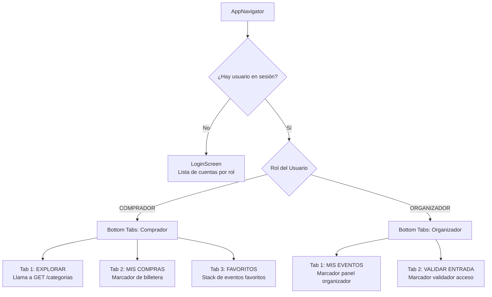

# Plan de Auditoría y Diseño Front-End (Fases 0 a 5)
## AI Ticket It — Pop Kinetic Mobile (React Native + Expo)

> **Documento de Auditoría y Planificación Visual / Técnica**  
> **Estado:** Fases 1 a 5 completadas (Front-end 100% implementado: Catálogo, Compras, Panel de Organizador, Validación QR/Cámara, Chat de Compra y Reseñas)  
> **Referencia Visual:** Exportación Stitch en `temp/`  
> **Fuente de Verdad Técnica:** `backend/docs/API.md` (25 endpoints montados, 5 estados canónicos)

---

## Decisiones del Estudiante (Definiciones Prioritarias)

1. **Flujo de Autenticación Real (Pop Kinetic):**  
   Reemplaza el selector de usuarios simulado anterior por autenticación real con tokens de sesión en memoria:
   - **Stack de Autenticación (`AuthStack`):** Consta de `WelcomeScreen` (pantalla de bienvenida con botones principales "Iniciar sesión" y "Crear cuenta"), `LoginScreen` (email y contraseña con alternancia de visibilidad) y `RegisterScreen` (selector táctil "Soy comprador" / "Soy organizador", nombre, apellido condicional para compradores, email, contraseña con validación local de 8 caracteres alfanuméricos y confirmación).
   - **Manejo de Sesión:** Persiste el token de sesión en `AsyncStorage` (`@ai_ticket_it:auth_token`), transmitiéndolo en el encabezado `Authorization: Bearer <token>`. El inicio de sesión y la derivación de pantallas están gobernados exclusivamente por el atributo `rol` retornado por el backend (`GET /usuarios/me`).
   - **Manejo de Desconexión:** Ante fallas transitorias de red al iniciar, la aplicación no borra la sesión almacenada y presenta un botón de reintento. Si el backend responde 401 Unauthorized en peticiones autenticadas, se produce el cierre de sesión automático.
2. **Validación de entradas (implementación en fase posterior):**  
   Se utilizará la cámara física mediante `expo-camera`, incorporando además un campo de ingreso manual del identificador de compra como mecanismo de respaldo. Los tickets del comprador exhibirán códigos QR generados 100% offline mediante `react-native-svg` y `react-native-qrcode-svg`. Queda terminantemente prohibido el uso de APIs o servicios externos para renderizar códigos QR.
3. **Omisión de Gemini y librerías web:**  
   Se omite `AIVibeModal` y toda lógica de Inteligencia Artificial externa, sin emplear ninguna de las dependencias externas del export web (`@google/genai`, `express`, `dotenv`, `motion`, `lucide-react`, `tailwind`).
4. **Esquema de navegación por rol:**  
   - **Comprador:** Tab Navigator con 3 pestañas: **"Explorar"**, **"Mis compras"** y **"Favoritos"**.
   - **Organizador:** Tab Navigator con 2 pestañas: **"Mis eventos"** y **"Validar entrada"**.  
   El perfil y reputación del organizador no ocupa una pestaña independiente, sino que se consulta navegando desde el detalle del evento.

---

## 1. Inventario del Material de Diseño (`temp/`)

### 1.1 Árbol de carpetas (2 niveles)

```text
temp/
├── .env.example
├── .gitignore
├── ai-ticket-it---pop-kinetic-mobile.zip
├── index.html
├── metadata.json
├── package.json
├── README.md
├── tsconfig.json
├── vite.config.ts
├── public/
│   └── assets/
│       └── aistudio/
├── src/
│   ├── App.tsx
│   ├── index.css
│   ├── main.tsx
│   ├── components/
│   │   ├── AIVibeModal.tsx
│   │   ├── EventCard.tsx
│   │   ├── FilterChip.tsx
│   │   ├── PopButton.tsx
│   │   ├── SearchBar.tsx
│   │   ├── StarburstBadge.tsx
│   │   └── TicketStub.tsx
│   ├── data/
│   │   └── mockEvents.ts
│   ├── native/
│   │   └── index.ts
│   ├── screens/
│   │   ├── HomeScreen.tsx
│   │   ├── MyTicketsScreen.tsx
│   │   ├── ScanVerifyScreen.tsx
│   │   └── TicketDetailScreen.tsx
│   ├── theme/
│   │   ├── colors.ts
│   │   ├── shadows.ts
│   │   └── typography.ts
│   └── types/
│       └── ticket.ts
└── stitch-export/ (descompresión idéntica de ai-ticket-it---pop-kinetic-mobile.zip)
```

### 1.2 Tecnología detectada
- **Naturaleza del código:** Es una aplicación **React Web** empaquetada con **Vite 8** y **TypeScript**, diseñada para previsualizarse en navegador simulando un marco de smartphone (iPhone/Pixel).
- **Capa de emulación:** En `src/native/index.ts` existe un polyfill DOM que implementa firmas de React Native (`View`, `Text`, `Pressable`, `StyleSheet`, etc.) traduciéndolas internamente a etiquetas HTML (`div`, `span`, `img`, `button`) para que corran en Vite.
- **Estilos:** Tailwind CSS v4 (`@tailwindcss/vite`), CSS tradicional en `index.css` y objetos tipados de `StyleSheet` con valores estáticos.
- **Animaciones y Efectos:** `motion` (Motion para React web).
- **Iconografía:** `lucide-react` (SVG web).

### 1.3 Dependencias del `package.json`
- **Producción:** `@google/genai` (^2.4.0), `@tailwindcss/vite` (^4.3.3), `@vitejs/plugin-react` (^6.1.1), `lucide-react` (^0.546.0), `react` (^19.0.1), `react-dom` (^19.0.1), `vite` (^8.3.0), `express` (^4.21.2), `dotenv` (^17.2.3), `motion` (^12.23.24).
- **Desarrollo:** `@types/node`, `@types/react`, `@types/react-dom`, `@types/express`, `autoprefixer`, `esbuild`, `tailwindcss`, `tsx`, `typescript`.

### 1.4 Servidor, Claves y APIs Externas
- **Servidor:** Posee scripts para levantar un preview local Vite en puerto 3000 con host `0.0.0.0`.
- **Claves:** No contiene archivos `.env` reales ni API keys secretas expuestas. Solo existe un `.env.example` con strings de plantilla genéricos: `GEMINI_API_KEY="MY_GEMINI_API_KEY"` y `APP_URL="MY_APP_URL"`.
- **APIs externas:** Presenta integración con la SDK de Gemini (`@google/genai`) para una funcionalidad experimental ("AI Vibe Intel") y peticiones a un servicio web de generación de imágenes QR (`https://api.qrserver.com/...`). Ambas quedan desacopladas para mantener el sistema 100% autónomo y offline.

---

## 2. Pantallas Diseñadas en el Export

A continuación se detalla cada vista visualmente maquetada en `temp/src/screens/`:

| Pantalla | Archivo de Origen | Propósito | Rol | Historia del TP Cubierta | Endpoint(s) Requeridos |
|---|---|---|---|---|---|
| **Catálogo y Descubrimiento** | `screens/HomeScreen.tsx` | Exploración de eventos en grilla/lista, filtrado por categorías, búsqueda de texto y destacados. | Comprador / Ambos | Comprador busca y explora por categoría; Ordenar por precio, fecha y puntaje | `GET /eventos`, `GET /categorias` |
| **Detalle de Evento y Compra** | `screens/TicketDetailScreen.tsx` | Ficha técnica del evento, selector de tipos de entrada (tiers), contador de cantidad, desglose de precio y acción de compra. | Comprador | Comprar eligiendo tipo y cantidad sin superar el cupo; Reseñas previas visibles en eventos del organizador | `GET /eventos/:id`, `POST /compras`, `POST /compras/:id/pagar` |
| **Billetera de Entradas** | `screens/MyTicketsScreen.tsx` | Lista de compras del usuario en formato de cupones/tickets físicos (`TicketStub`), pestañas "Activas" y "Pasadas". | Comprador | Comprador ve sus compras con estado y días restantes; Comprador cancela compra | `GET /compras/mias`, `GET /compras/:id` |
| **Validador de Acceso** | `screens/ScanVerifyScreen.tsx` | Retícula óptica con efecto escáner para control en puerta y validación de autenticidad. | Organizador | Cancelación permitida solo si no está utilizada y el evento no se realizó (Validar entrada O5) | `POST /compras/:id/utilizar` |
| **Modal AI Vibe** | `components/AIVibeModal.tsx` | Modal flotante con análisis de estilo y afinidad musical de evento. | Comprador | *Fuera de alcance TP (Omitido)* | Ninguno (UI estática / cosmética) |

---

## 3. Tokens de Diseño (Pop Kinetic Design System)

El diseño se basa en una estética **Neo-Brutalista Pop Art** inspirada en Roy Lichtenstein: colores primarios puros, fondos de papel prensa (*newsprint*), bordes negros de trazo grueso (2 a 2.5px) y sombras desplazadas sólidas sin difuminar (*hard drop shadows*).

### 3.1 Paleta de Colores

#### Superficies y Lienzo (*Newsprint*)
- `canvasBase`: `#FAF8F5` (Fondo general de pantallas, emula papel prensa sin estucar).
- `canvasTint`: `#FFFDF0` (Fondo de tarjetas elevadas y cupones de ticket).
- `surfaceContainer`: `#EFEEEB` (Contenedores neutros y separadores).
- `surfaceDim`: `#DBDAD7` (Fondos atenuados, botones secundarios inactivos).
- `white`: `#FFFFFF` (Blanco puro para contrastes interiores).

#### Primarios Gráficos (*Lichtenstein Inks*)
- `electricCobalt`: `#2563EB` (Azul primario: botones de acción principal, estado Confirmado, badges destacados).
- `cobaltDark`: `#004AC6` (Variante profunda para pressed y contrastes).
- `cobaltLight`: `#DBE1FF` (Contenedor tintado suave).
- `popVermilion`: `#F43F5E` (Magenta / bermellón: estados urgentes, alertas, reembolsos).
- `vermilionDark`: `#B90538` (Acento oscuro).
- `vermilionLight`: `#FFDADB` (Fondo de alerta y cancelación).
- `canaryYellow`: `#FACC15` (Amarillo canario: acento terciario, badges Pop, estrellas, compras pendientes).
- `canaryDark`: `#CEA700` (Acento amarillo oscuro).
- `canaryLight`: `#FFE083` (Fondo suave de tickets VIP).

#### Estructurales y Tintas
- `inkBlack`: `#0A0A0A` (Color unificado para bordes de 2–2.5px, textos principales y sombras duras).
- `inkBlackMuted`: `#1B1C1A` (Color para textos secundarios).
- `onSurfaceVariant`: `#434655` (Texto complementario).
- `outline`: `#737686` (Bordes auxiliares).

#### Mapeo Semántico Obligatorio de los 5 Estados de Compra del Backend
Para mantener coherencia estricta con la máquina de estados del backend:

| Estado Backend | Color de Fondo | Color de Texto / Borde | Semántica Visual Pop Kinetic |
|---|---|---|---|
| `PENDIENTE` | `canaryYellow` (`#FACC15`) | `inkBlack` (`#0A0A0A`) | Compra reservada; llama a la acción de pago rápido. |
| `CONFIRMADA` | `electricCobalt` (`#2563EB`) | `white` (`#FFFFFF`) | Entrada paga y vigente; lista para el evento. |
| `UTILIZADA` | `surfaceDim` (`#DBDAD7`) | `onSurfaceVariant` (`#434655`) | Entrada consumida en acceso; cupón perforado/sellado. |
| `CANCELADA` | `surfaceContainer` (`#EFEEEB`) | `outline` (`#737686`) | Cancelación desde estado pendiente; cupón anulado. |
| `REEMBOLSADA` | `vermilionLight` (`#FFDADB`) | `popVermilion` (`#F43F5E`) | Reembolso registrado; badge rojo con aviso de devolución. |

### 3.2 Tipografía

Se compone de dos familias de fuentes de Google Fonts:
1. **Titulares y Rótulos de Impacto:** `Bricolage Grotesque` (`BricolageGrotesque_600SemiBold`, `BricolageGrotesque_700Bold`, `BricolageGrotesque_800ExtraBold`).
2. **Cuerpo, Rótulos Técnicos y Metadatos:** `Space Grotesk` (`SpaceGrotesk_400Regular`, `SpaceGrotesk_500Medium`, `SpaceGrotesk_600SemiBold`, `SpaceGrotesk_700Bold`).

### 3.3 Bordes y Sombras Duras (`HardShadow`)

- **Bordes:** Todos los componentes clave llevan contorno negro sólido (`borderColor: '#0A0A0A'`).
  - Grueso: `borderWidth: 2.5` (Botones de acción, tarjetas de eventos, cupones).
  - Estándar: `borderWidth: 2` (Chips de categorías, inputs, modales).
  - Fino: `borderWidth: 1.5` (Separadores y marcos interiores).
- **Sombras Duras Pop Art (Arquitectura `HardShadow`):**  
  **NO se utiliza `shadowOffset` ni `elevation`**, dado que en Android no producen una sombra dura sin difuminar. En su lugar, el componente `HardShadow` renderiza una vista sólida de color `#0A0A0A` ubicada físicamente detrás del contenedor y desplazada mediante `transform: [{ translateX: offset }, { translateY: offset }]`.  
  Al presionar (`PopButton`), el contenedor se traslada hacia abajo y a la derecha, reduciendo la distancia visual con la sombra y produciendo una compresión mecánica tangible.
  - Tarjeta normal: `offset = 4`
  - Elemento interactivo / Botón: `offset = 3`
  - Badge / chip pequeño: `offset = 2`

---

## 4. Componentes Reutilizables Implementados

1. **`HardShadow`**: Componente de sombra física dura (#0A0A0A) detrás del contenido.
2. **`PopButton`**: Botón táctil con borde negro de 2.5px, sombra dura desplazada y variantes `primary`, `secondary`, `danger` y `canary`.
3. **`StateBadge`**: Píldora de estado con los colores exactos para `PENDIENTE`, `CONFIRMADA`, `UTILIZADA`, `CANCELADA` y `REEMBOLSADA`.
4. **`PopInput`**: Campo de entrada viñeta cómic con etiqueta y reporte de errores.
5. **`Screen`**: Contenedor con `SafeAreaView` y fondo de papel prensa `#FAF8F5`.
6. **`LoadingView`**, **`EmptyState`**, **`ErrorBanner`**: Estados auxiliares de carga, vacío y error con botón de reintento.
7. **`Header`**: Barra superior unificada con logo Pop Art, nombre de usuario activo, pastilla de rol y botón de cierre de sesión.
8. **`FavoriteButton`**: Botón táctil con icono de corazón (lleno bermellón o contorno), borde negro de 2px, sombra dura Pop Kinetic y aislamiento de propagación de eventos, reservado exclusivamente para compradores.

---

## 5. Cobertura contra las 12 Historias del Enunciado del TP

| Historia del TP | Estado en Front-End | Estrategia de Resolución |
|---|---|---|
| **Comprador ve sus compras con estado y días restantes** | Comprobado (Fase 3: `MisComprasScreen` y `CompraDetalleScreen`) | En la pestaña *"Mis compras"* se muestran las compras de `GET /compras/mias`, los 5 badges de estado, el cupón troquelado `TicketCard` y el indicador `"Faltan N días"`. |
| **Organizador ve compras de un evento con disponibilidad** | Comprobado (Fase 4: `VentasEventoScreen`) | Desde la pestaña *"Mis eventos"*, se accede a la vista de ventas por evento con disponibilidad por tipo de entrada (`GET /eventos/:id/compras`), barras de ocupación y canje de accesos. |
| **Comprador busca y explora por categoría** | Comprobado (Fases 1 y 2: `ExplorarScreen`) | Llama a `GET /categorias` con filtro de categoría en `GET /eventos?categoria=...`, búsqueda en vivo por texto `q` y orden. |
| **Organizador crea evento con tipos de entrada** | Comprobado (Fase 4: `CrearEventoScreen`) | Formulario para `POST /eventos` con agregado dinámico de tipos de entrada (nombre, precio, cupo inicial), validación de fecha local y chips de categoría. |
| **Comprador envía mensajes** | Comprobado (Fase 5: `ChatCompraScreen`) | Chat accesible desde `CompraDetalleScreen` consumiendo `POST /compras/:id/mensajes` y `GET /compras/:id/mensajes`, con autoscroll, burbujas Pop Art, contador de 1000 caracteres y polling cada 5s en primer plano. |
| **Organizador responde mensajes** | Comprobado (Fase 5: `ChatCompraScreen` y `VentasEventoScreen`) | Misma pantalla de chat reutilizada para el organizador, con acceso directo desde cada fila en `VentasEventoScreen` o desde el detalle de la compra. Permite conversar en cualquier estado (incluso canceladas/reembolsadas). |
| **Comprador cancela compra** | Comprobado (Fase 3: `CompraDetalleScreen`) | Botón de cancelación en el detalle de la compra invocando `POST /compras/:id/cancelar` con confirmación Pop Art. |
| **Cancelación permitida solo si no está utilizada y el evento no se realizó** | Comprobado (Fase 3: `puedeCancelar` del back) | Regla regida por el backend: el botón de cancelar solo se muestra si `puedeCancelar === true`, mostrando mensaje descriptivo cuando está `UTILIZADA`. |
| **Comprador puntúa y comenta** | Comprobado (Fase 5: `CompraDetalleScreen` y `RatingInput`) | Formulario modal de reseña disponible exclusivamente cuando `puedeResenar === true` (`POST /compras/:id/resena`), con selector táctil de 1 a 5 estrellas, comentario de hasta 500 caracteres, recarga de estado a `resenada: true`, visualización de "Tu reseña" y badge `CALIFICÁ`/`RESEÑADA` en `TicketCard`. |
| **Reseñas previas visibles en eventos del organizador** | Comprobado (Fase 2: `OrganizadorPerfilScreen`) | Pantalla de perfil de organizador accesible desde el detalle del evento para ver su puntaje promedio y opiniones. |
| **Ordenar por precio, fecha y puntaje** | Comprobado (Fase 2: `ExplorarScreen`) | Selector de orden en la cabecera del catálogo (`orden=precio_asc`, `fecha_asc`, `puntaje_desc`). |
| **Comprar eligiendo tipo y cantidad sin superar el cupo** | Comprobado (Fase 3: `EventoDetalleScreen`) | Selector de tipo de entrada y `QuantityStepper` limitado al `cupoRestante` en el detalle del evento (`POST /compras`). |
| **Comprador guarda eventos favoritos** | Comprobado (`FavoritosScreen`, `FavoriteButton`, `EventCard`, `EventoDetalleScreen`) | Pestaña *"Favoritos"* exclusiva para compradores (`GET /favoritos`), corazón Pop Kinetic para alternar estado (`POST /favoritos/:id` y `DELETE /favoritos/:id`) con protección anti-doble toque y refresco por foco. |

---

## 6. Navegación por Rol Implementada (Decisión 4)


